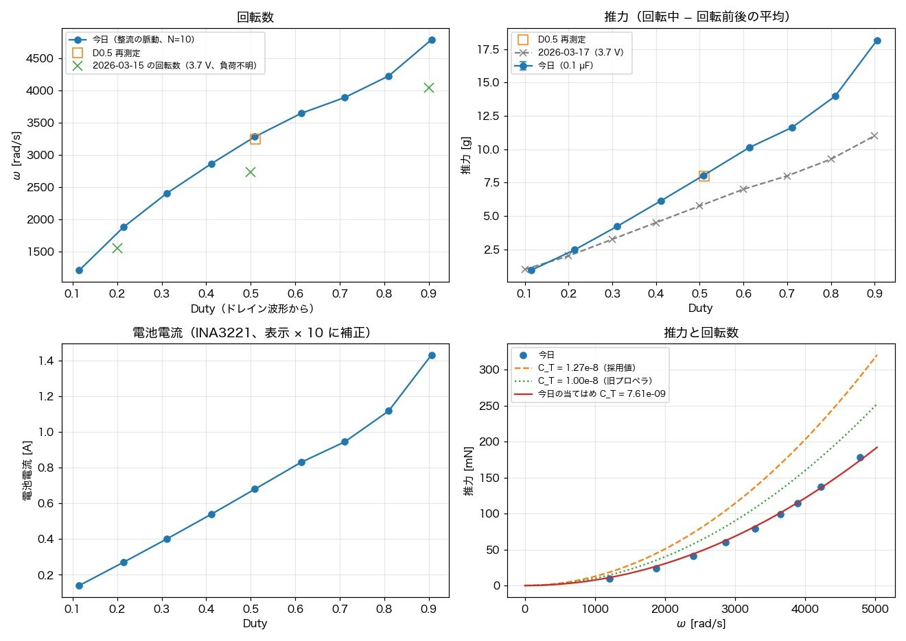
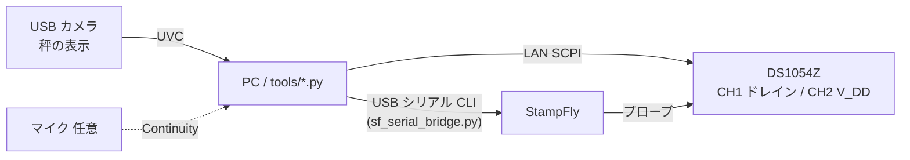
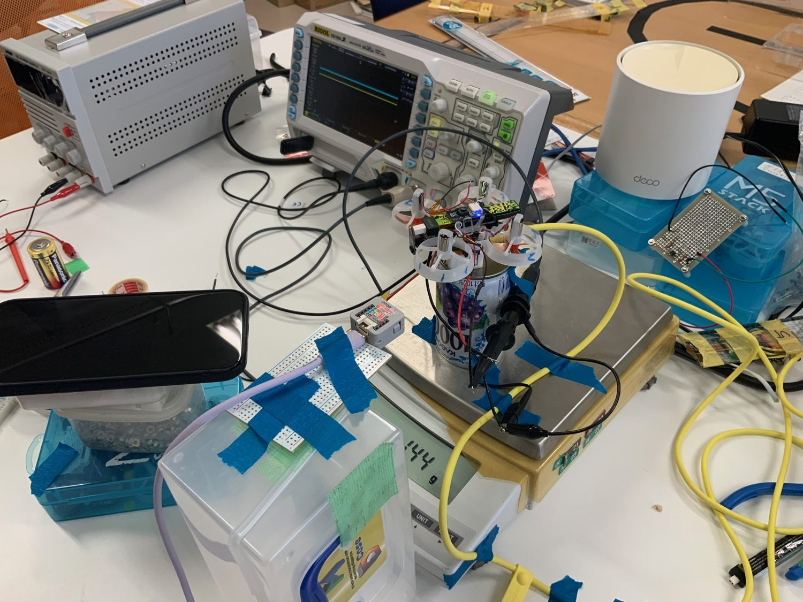
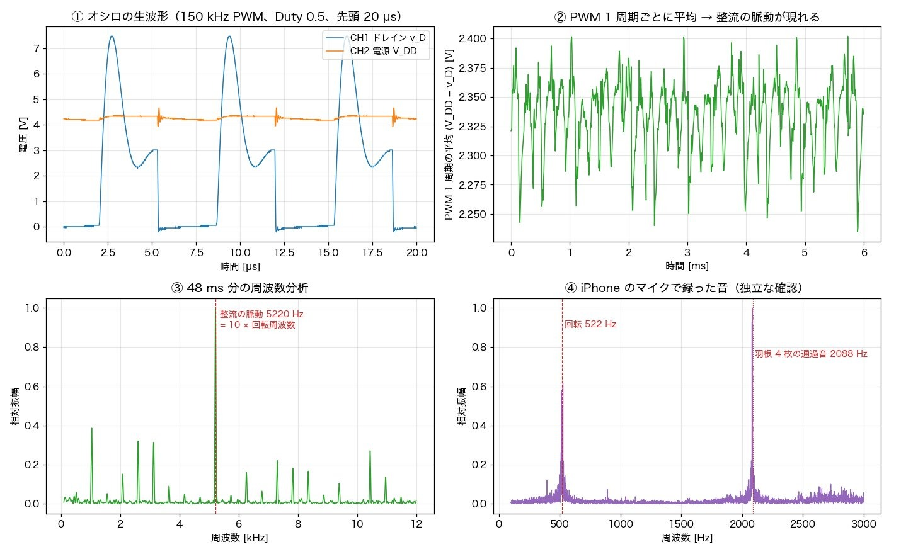
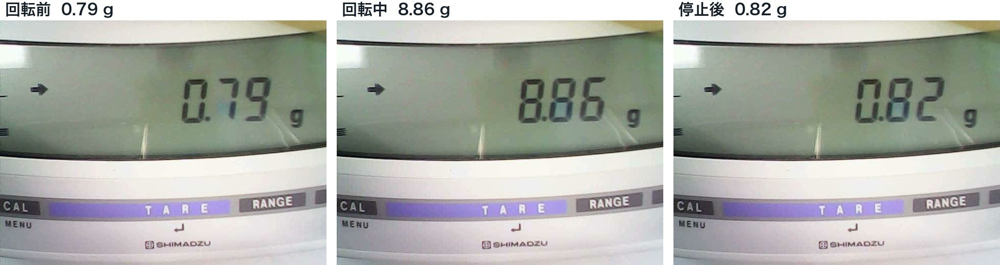
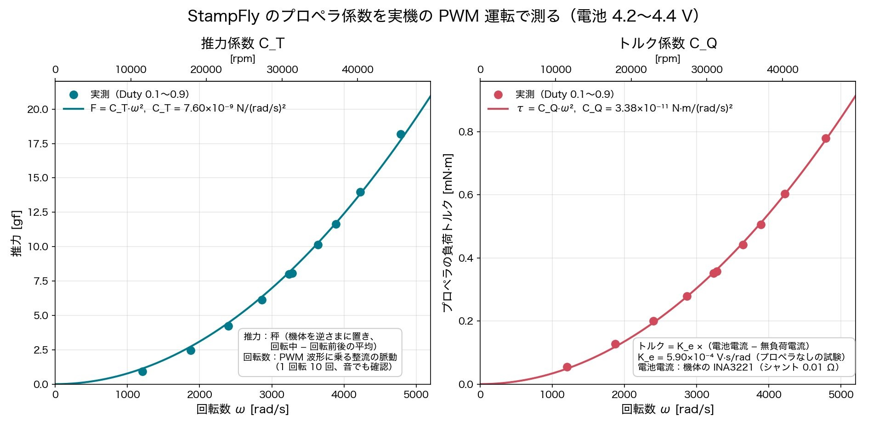
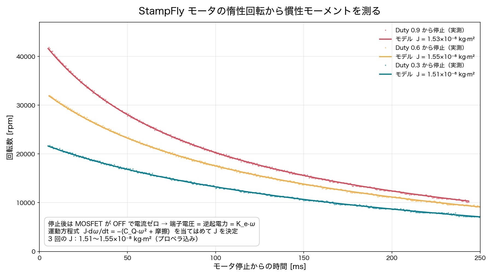

# StampFly モータ・プロペラ定数の完全自動取得

**English summary.** Scripts that automatically measure the motor and propeller constants of a StampFly
(K_e, R, C_T, C_Q, no-load current I_0(ω), rotor inertia J, rotor speed) from a PC. The PC drives the
board through its USB serial CLI, captures the drain and V_DD waveforms with a RIGOL DS1054Z over LAN (SCPI),
reads a scale display with a USB camera, and derives the rotor speed from the commutation ripple in the
PWM-period-averaged motor voltage. This repository is an example for one specific board and one motor;
the values below are for that motor only.

## 概要

PWM 駆動中の StampFly について、次の量を PC から自動で取得する。

- K_e（逆起電力定数）、R（モータ巻線＋経路の抵抗）
- C_T（推力係数）、C_Q（トルク係数）
- プロペラなしの無負荷電流 I_0(ω)
- 慣性モーメント J（スピンダウン試験）
- 回転数（整流子の脈動から）

2026-10-15 の測定結果（1 個のモータ、搭載プロペラ）:

| 量 | 値 |
|---|---|
| K_e | 5.90e-4 V·s/rad |
| R | 0.594 Ω |
| C_T | 7.60e-9 N/(rad/s)² |
| C_Q | 3.38e-11 N·m/(rad/s)² |
| 無負荷電流 I_0(ω) | 0.044 + 2.9e-9·ω² A |
| J（プロペラ付き） | 1.54e-8 kg·m² |
| J（ロータのみ） | 3.46e-9 kg·m² |
| 1 回転あたりの脈動数 N | 10 |

注意（2026-11-02 追記）: 2026-11-02 夜に同じプロペラで測り直すと、$C_T$ は原点を通る当てはめで 7.27e-9 だった（各 Duty で 10/15 より 2〜5 % 小さい。原因は未特定）。$C_Q$ は 3.33e-11 で一致した。ケーブルを机にも固定する留め方は、ゼロをずらすだけで推力の読みは変えないことを、同じ夜に確かめた。同じ日に一度書いた「留め方で $C_T$ がずれた可能性」は誤りで、その日の推力のずれの原因は、秤のマイナス表示を読み落としたことだった。記録は docs/procedure_long_discharge.md 10 章。
Caveat (added 2026-11-02): a redo with the same propeller on the evening of 2026-11-02 gave $C_T$ = 7.27e-9 through the origin (2-5 % lower than 2026-10-15 at every duty; cause not yet found) and $C_Q$ = 3.33e-11 (agrees). Taping the cables to the table only shifts the scale zero and does not change the thrust readings (checked the same evening). An earlier note of the same day blaming the cable routing was wrong: that day's thrust offsets came from reading negative scale values without their minus sign. See docs/procedure_long_discharge.md section 10.

測定の素データ（オシロの .npz）は容量が大きいので置かず、要約（`data/2026-10-15/`）だけを置いている。



## 構成

- PC と StampFly を USB シリアルでつなぎ、CLI（`motor test` / `motor stop` / `sensor power`）で駆動と電池電圧の読み取りを行う。
- オシロスコープ RIGOL DS1054Z を LAN 経由の SCPI で制御し、波形のメモリ全体を取り込む。
- インターフェースのない秤の表示は、USB カメラ（M5Stack AtomS3R-CAM を UVC カメラとして使用）で撮影して読む。
- 任意：macOS の連係機能（Continuity）で iPhone のマイクを使い、羽根の通過音を録音する。





## 測定の原理

- **回転数**: ブラシ付きモータは回転に同期した電圧の脈動を出す。PWM 1 周期ごとに V_DD − v_D を平均し（周期ちょうどの窓）、その系列を FFT して脈動の周波数 f を求める。ω = 2π·f / N（N = 10）。
- **推力**: 秤の読みは「回転中の平均 − 回転前後の平均」とする。秤の線形なドリフトが打ち消される。
- **トルク**: C_Q·ω² = K_e·(I − I_0(ω))。I はバッテリ電流（補正後）、I_0 はプロペラなしの電流。
- **K_e と R**: モータ平均電圧 ⟨v_m⟩ = R·I + K_e·ω を、プロペラなしと付きの複数の動作点で最小二乗する。
- **J**: MOSFET を OFF にしてスピンダウンさせると、モータ電流は 0 で端子電圧 = 逆起電力 K_e·ω となる。J·dω/dt = −(C_Q·ω² + K_e·I_0(ω)) から J を求める。



## 工夫

- **シリアルポートを開くたびに基板が再起動する**ため、`sf_serial_bridge.py` がポートを開いたままにして、名前付きパイプ（FIFO）でコマンドを受ける。
- オシロは、トリガの辺が来ない場合（モータ停止など）に強制トリガをかける。
- 秤の LCD の更新中は桁がずれた画像が混じるため、9 枚連続で撮影して読める画像を使う。
- 回転前・回転中・回転後の読みで秤のドリフトを打ち消す。
- バッテリ電流の不一致の発見と補正: StampFly のファームの INA3221 ドライバはシャント 0.1 Ω を仮定するが、基板の R12 は 0.01 Ω（回路図）であり、表示電流は実際の 1/10 だった。`SF_CURRENT_SCALE`（既定 10.0）で補正する。



## 使い方

### インストール

```bash
pip install -r requirements.txt
# カメラ・録音には ffmpeg（macOS の avfoundation を使用）
```

### 環境変数

| 変数 | 既定 | 内容 |
|---|---|---|
| `SCOPE_IP` | なし（必須） | オシロの IP（`--scope-ip` でも指定可） |
| `AUTOTEST_DATA` | `./data` | 出力フォルダ（`--data DIR` でも指定可） |
| `SF_BRIDGE_DIR` | `~/.cache/sf_serial_bridge` | シリアル中継のフォルダ（0700）、FIFO（0600） |
| `SF_CAM_NAME` | `AtomS3R-CAM` | 秤を撮る USB カメラのデバイス名 |
| `SF_MIC_NAME` | 空 | マイクのデバイス名。空なら録音しない |
| `SF_CURRENT_SCALE` | `10.0` | 電池電流の補正倍率（上記のシャント不一致） |
| `PWM_FREQ_HZ` | 解析 150096.67（取り込み側 150e3） | PWM 周波数 |
| `CH2_DELAY_NS` / `CH2_GAIN` / `CH2_OFFSET_V` | 0 / 1.0 / 0.0 | CH2 プローブの補正。自分のプローブ 2 本を同じ節点につないだ試験で求める。既定は補正なし |

### 配線

CH1 = ドレイン、CH2 = V_DD、GND は共通。

### 実行

```bash
export SCOPE_IP=<オシロの IP>
export AUTOTEST_DATA=./data/mytest

# 1) シリアル中継を起動（別のターミナルで常駐）
python3 tools/sf_serial_bridge.py

# 2) PWM 1 段
python3 tools/exp_auto.py pwm_c01_d50 1 50 --sec 14

# 3) Duty 掃引（モータ 1、タグ c01、電池が 3.6 V を下回ったら停止）
tools/exp_batch.sh 1 c01 3.6

# 4) プロペラなしの掃引
DUTIES="10 20 30 40 50 60" tools/exp_batch.sh 1 np01

# 5) スピンダウン（タグ、Duty %、回す秒数、オシロの time/div）
python3 tools/exp_coast.py coast_p_d60 60 4 0.05 --motor 1   # プロペラ付き: 4 秒回して停止、50 ms/div（プロペラなしは 0.1 s/div）

# 6) 解析（掃引のまとめ → summary.json）
python3 tools/analyze_rpm_sweep.py

# 7) 定数の当てはめ（K_e・R・I_0・C_T・C_Q・J）。同梱の data/2026-10-15 でそのまま再現できる
python3 tools/fit_constants.py --data data/2026-10-15
```

`data/2026-10-15/coast_omega.csv` は、スピンダウン 9 回の、停止後の端子電圧（PWM 周期より長い区間で平均）と ω = v_m / K_e（K_e = 5.905e-4）である。生の波形（1 回 600 万点）は容量が大きいため同梱していない。

秤の写真は測定中に保存し、後から読む。今回の試験では、写真から読み取った値を AI アシスタントが
`thrust_readings.json` に書き写した（形式は `{tag: {"before": [...], "spin": [...], "after": [...]}}`、単位 g）。
`exp_auto.py` は `<data>/img/` に写真（と、`--audio` 指定時は録音）を保存する。

手順メモ（計画段階の DC 手動測定を含む。実際には PWM 運転だけで定数がそろったため DC 測定は行っていない）: [docs/procedure_2026-10-15.md](docs/procedure_2026-10-15.md)




## 注意

- 安全: プロペラ付きで回転させる。保護具を使い、機体を固定し、人の近くで回さない。LiPo 電池の過放電・短絡に注意する（`exp_batch.sh` は電池電圧が下限を下回ると止まる）。
- これは特定の基板（StampFly）と特定のモータ 1 個での例である。値は個体差があり、他のモータにそのまま当てはまるとは限らない。
- 電流の補正倍率やプローブの補正は、使う基板・プローブごとに確認すること。
- `analyze_rpm_sweep.py` のタグ名（`pwm_` で始まるもの）と `N = 10`、PWM 周波数は、この測定に合わせた値である。

## ライセンス

MIT（`LICENSE`）
